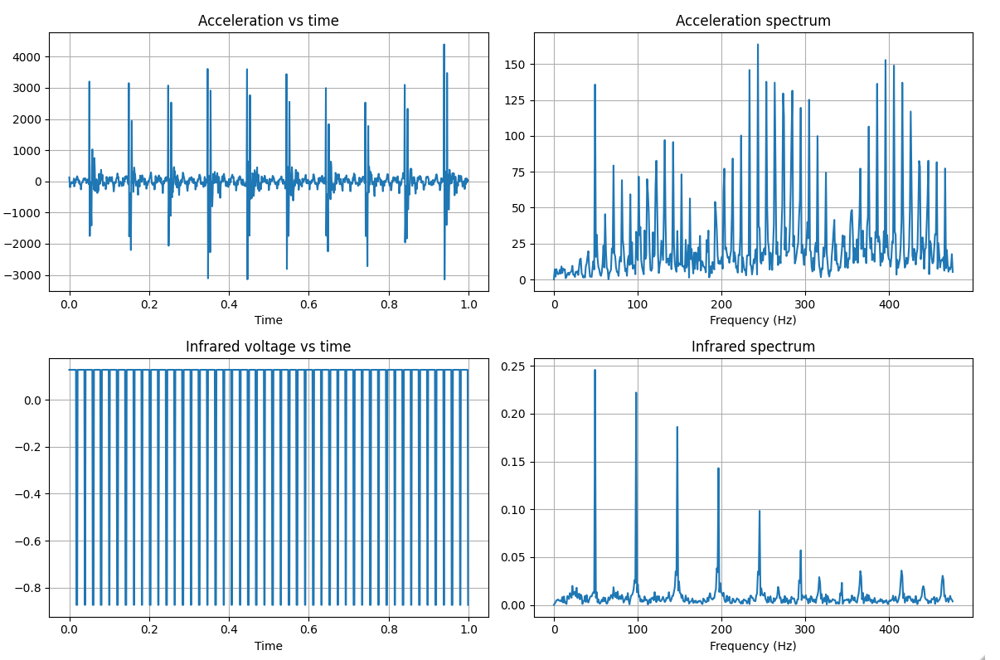

# Rotor Balancer

> **Project Status:** Paused / reference implementation. The Python analysis package has been modernized and verified offline against the included `measurements/` dataset, but the hardware project is not actively developed at the moment.

Single-plane rotor balancer and tachometer using an Arduino Nano 33 BLE. Built to balance quadcopter propellers or polygon laser scanner mirror motors.

The Nano 33 BLE pulses the motor via hardware PWM and records acceleration via its onboard LSM9DS1 accelerometer chip while reading a [TCRT5000 IR LED](https://opencircuit.nl/Product/TCRT5000-Infrarood-lijn-detectie-module) optical trigger to track rotor phase.
The amplitude of the accelerometer signal is proportional to the unbalanced mass, and the phase difference between the infrared trigger and the accelerometer indicates where balance putty should be applied.
In the case of two-plane unbalance, the phase difference between the IR LED and the accelerometer can depend on rotor speed.
So far, only the single-plane two-run method is implemented.


## Installation & Usage

### 1. Firmware (`nano33ble/`)
Compile and upload the firmware in `nano33ble/` using PlatformIO (VS Code plugin) or Arduino CLI to your Arduino Nano 33 BLE, then connect over serial at `115200` baud. Five menu options are available: start sampling, calibrate the IR sensor, spin the polygon, check pulse frequency, and set pulse frequency.

Place a small piece of aluminum tape on the rotor, verify the IR sensor detects it, and adjust the threshold screw on the TCRT5000 module so it triggers cleanly once per revolution. Menu loops typically exit by sending `1`.

### 2. Python Host Tools (`src/rotorbalancer/`)
Install dependencies with [uv](https://docs.astral.sh/uv/) (recommended, Python >= 3.10):

```console
uv sync
uv run rotorbalancer --plot --frequency 20 --filename 20hertz.p
```

Or install cleanly into a standard virtual environment with `pip`:

```console
pip install -e .
python -m rotorbalancer.main --plot --frequency 20 --filename 20hertz.p
```

Batch sweeps and offline analysis can also be run from Python (see example datasets in `measurements/` and [notebooks/trials.py](notebooks/trials.py)):

```python
from rotorbalancer import tools

# Analyze recorded runs (pass method="details" for cycle-by-cycle sine fitting)
df = tools.loadfiles("without_weight", method="fft")
print(df.describe())

# Or capture a sweep on hardware
# tools.runtest(10, 11, 1, "test")
```

Run tests and linter offline on the included `measurements/` dataset:

```console
uv run pytest -v
uv run ruff check src tests
```

## Repository Map

| Path | Purpose |
| :--- | :--- |
| [src/rotorbalancer/](src/rotorbalancer/) | FFT/sine-fit analysis (`calc.py`), CLI sampler (`main.py`), batch sweep/dataframe tools (`tools.py`) |
| [nano33ble/](nano33ble/) | PlatformIO / Arduino Nano 33 BLE firmware & modified LSM9DS1 library |
| [measurements/](measurements/) | Recorded vibration & IR datasets (`without_weight/`, `weight/`, `weight_5/`) |
| [notebooks/trials.py](notebooks/trials.py) | Exploration script comparing unbalanced vs. balanced runs |
| [caddesigns/](caddesigns/) | Nano 33 BLE holder STLs & stabilizer FreeCAD CAD design |
| [tests/](tests/) | Automated `pytest` verification against recorded datasets and multi-resolution FFTs |

## Video
I made a video of the setup for a better impression:

[](https://youtu.be/xFNtZbOfEfQ)


## Measurements
<br>

For each measurement, the rotor is pulsed at a set frequency for 20 seconds to spin up.
The motor is kept running while acceleration and the infrared signal are sampled for 1 second at 952 Hz (the maximum sample rate of the LSM9DS1 accelerometer).
In single-plane balancing it is assumed that the force angle is independent of speed within the operating range.
The phase difference between the IR sensor and accelerometer determines where putty needs to be applied.
Frequency and amplitude are extracted via Fourier transform (first fundamental peak detection) or per-revolution sinusoid fitting (`calc.getdetails`).
Results are repeatable with standard deviation in the range of 1–3% (see [notebooks/trials.py](notebooks/trials.py) and `measurements/`).
A balance weight of 0.060 g [Weicon resin putty](https://www.weicon.de/en/products/adhesives-and-sealants/2-component-adhesives-and-sealants/epoxy-resin-systems/plastic-metal/298/epoxy-resin-putty) was weighed using a Mettler Toledo AG204 DeltaRange balance.
As a lower-cost alternative, small strips of aluminum tape can be cut to match mass by surface area, and a small strip is also used to trigger the IR LED sensor.
Further literature can be found on [ScienceDirect](https://www.sciencedirect.com/science/article/pii/S2351988616300185) and [National Instruments](https://forums.ni.com/t5/Example-Programs/Two-Plane-Balancing-Example-with-DAQmx/ta-p/3996066?profile.language=en).


## Implementation Details
On Linux, `ModemManager` interfered with the Arduino serial connection and had to be removed (see [Arduino forum](https://forum.arduino.cc/index.php?topic=575194.0)):
```console
sudo apt --purge remove modemmanager
```
The accelerometer library from [SparkFun](https://github.com/sparkfun/SparkFun_LSM9DS1_Arduino_Library) is included in `nano33ble/lib/` in a slightly modified form.


## Related Open-Source Projects & Future Directions
Open-source dynamic balancing projects remain relatively rare compared to commercial industrial rigs, though two complementary references are worth noting:
* **[indeterminatedesign/DynamicBalancer](https://github.com/indeterminatedesign/DynamicBalancer):** Open-source ESP32 + MPU6050 + Hall-effect phase trigger + 3D-printed desktop spin balancer.
* **[MagedMohamedTurk/Turbomachinery-Rotors-Balancing](https://github.com/MagedMohamedTurk/Turbomachinery-Rotors-Balancing):** Python implementation of multi-plane Influence Coefficient balancing equations.

If this project is revisited for a v2, the main upgrades would be:
* **Hardware-timed phase + synchronous lock-in demodulation:** Timestamp each IR trigger via hardware interrupt (microsecond precision) and project accelerometer samples onto `cos(θ)` / `sin(θ)` per revolution, eliminating FFT bin quantization and RPM-drift errors.
* **Influence Coefficient Method (1-plane & 2-plane):** Measure baseline (`V_0`) and known trial-weight (`V_t`) complex vectors to compute `W_corr = -V_0 / a` (1-plane) or `W_corr = -A⁻¹ × V_0` (2-plane) directly without modeling suspension stiffness.
* **6-DOF SPI IMU upgrade:** Combine accelerometer (static force) and gyroscope (tilting couple moment) measurements from a fast SPI IMU (such as ICM-42688-P) when 2-plane balancing is needed.
* **Practical correction:** Convert computed correction mass directly into calibrated aluminum-tape strip length (mm) for manual placement, rather than attempting automated wax/putty dispensing.


## BOM
* **Prism:** 4 sides, 30×30×2 mm
* **Mirror motor:** Panasonic AN44000A (other motors require different pinouts). Has 5 pins: `PWM` (speed control, not linear for all motors), `MOTOR_EN`, `GND`, `Voltage` (ideally 24 V), and `LCK_PIN` (low when encoder and reference clock are out of sync). `LCK_PIN` and `MOTOR_EN` are kept fixed for repeatability.
* **Accelerometer:** LSM9DS1 onboard the Arduino Nano 33 BLE.
* **IR sensor:** TCRT5000 IR LED module (see [DIY LP turntable](https://www.stockholmviews.com/wp/diy-lp-turntable-tachometer/), bought at [OpenCircuit](https://opencircuit.nl/Product/TCRT5000-Infrarood-lijn-detectie-module)).
* **Balancing putty:** Two-component epoxy resin putty from [Weicon](https://www.weicon.de/en/products/adhesives-and-sealants/2-component-adhesives-and-sealants/epoxy-resin-systems/plastic-metal/298/epoxy-resin-putty) or single-component UV-curable putty from [Schenck](http://www.schenck-worldwide.com/PDF/de-de1/Epoxidharz-Unwucht-Korrektursystem.pdf) (German: *Wuchtkitt*, ceramic-filled, ~2 g/cm³, ordered via [Modulor](https://www.modulor.de); turns green after mixing and cures hard over several hours). Alternatively, use lead or metal tape (lead density ~11 g/cm³).
* **Optical plate:** Thorlabs aluminum breadboard with M6 screws as base. Avoid rigidly bolting the test unit to heavy structures; decouple it on foam or suspend it on cords (the prism motor assembly was suspended with strings during measurements).
